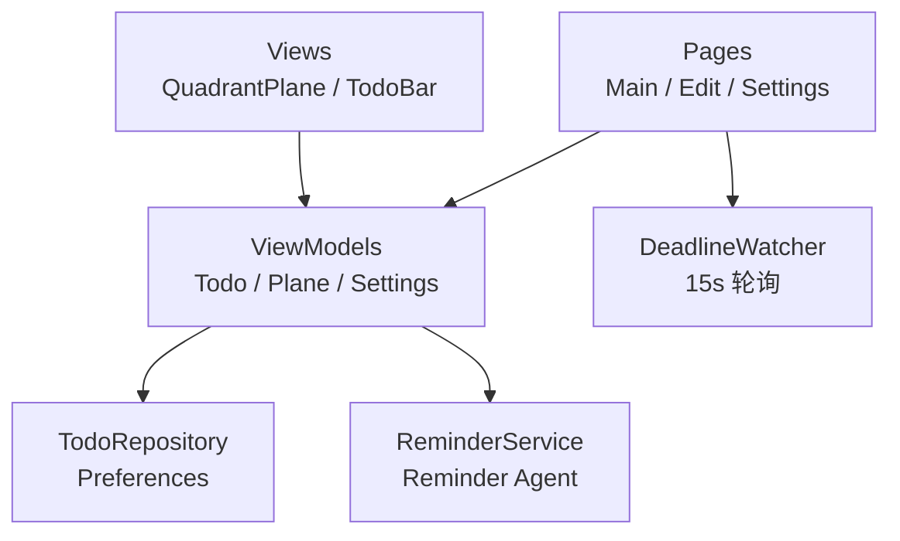

# Quadrant Todo · 鸿蒙四象限待办

一个运行在 HarmonyOS 上的单机待办应用。它不把待办排成线性列表，而是把每条待办画成**四象限平面**上的一个可拖动条：横轴是紧迫度（Urgency），纵轴是重要性（Significance）。拖动条形即可调整优先级，颜色随所在象限实时变化。

- 工程名：`TodoApp`
- 应用内名称：Quadrant Todo
- Bundle Name：`com.example.todoapp`
- 目标平台：HarmonyOS 6.0（API 26），设备类型 `phone`

## 功能

### 四象限平面

- 使用 Canvas 绘制网格、坐标轴、象限底色与标签，平面无限延伸，平移和缩放不会"拖到头"。
- 双指捏合缩放（0.1×–16×），以捏合中心为锚点，缩放时手指下的世界坐标保持不动。
- 单指拖动空白区域平移画布；`-` / `+` 按钮以画布中心为锚点按 1.25× 步进缩放。
- 坐标原点为 `0 / 0`，向右、向上为正；坐标值不设上下限。

### 待办条

每条待办以 144 × 48 vp 的色条叠加在平面之上，颜色由它当前所在的象限决定。

| 手势 | 行为 |
| --- | --- |
| 长按 350 ms | 选中该条，显示 Edit / Delete 操作 |
| 长按后拖动 | 移动待办，松手后把位移换算成紧迫度 / 重要性并持久化（已完成项不可拖动） |
| 单击 | 展开 / 收起描述（仅当待办带描述时） |
| 双击 | 切换完成 / 未完成 |
| 点击空白处 | 取消选中 |

其他视觉反馈：

- 已完成的条形半透明并带删除线。
- 有描述的待办在标题右侧显示一个小圆点。
- 设置了截止时间的待办在条形下方显示 `Due` / `Overdue` 与具体时间，逾期时文字变红。
- 跨象限拖动时颜色有 320 ms 的缓动过渡。

### 象限与配色

边界值（恰好为 0）归入 `>= 0` 的一侧。

| 象限 | 含义 | 坐标 | 颜色 |
| --- | --- | --- | --- |
| Q1 | 紧迫且重要 | x ≥ 0，y ≥ 0 | 红 `#E53935` |
| Q2 | 重要但不紧迫 | x < 0，y ≥ 0 | 蓝 `#1E88E5` |
| Q3 | 既不紧迫也不重要 | x < 0，y < 0 | 橙 `#FB8C00` |
| Q4 | 紧迫但不重要 | x ≥ 0，y < 0 | 灰 `#757575` |

### 新建 / 编辑

- 标题必填，描述可选。
- 截止时间默认关闭；打开后通过 `DatePicker` + `TimePicker` 选择日期和时间。
- 紧迫度与重要性**不在表单里设置**：新建的待办落在原点 `0 / 0`，之后在平面上拖动条形来调整；编辑时保留原坐标。

### 提醒

- 启动时申请通知权限，被拒绝也不影响其他功能。
- 每条「有截止时间且未完成」的待办会通过 Reminder Agent 注册日历提醒：一条在截止前 `N` 分钟（提前量），一条在截止时刻。待办或设置发生变化时会整体重排，删除 / 完成时取消。
- 应用运行期间，`DeadlineWatcher` 每 15 秒扫描一次。若有待办在本次运行中到期，会弹出对话框（可直接 Mark done）并补发一条系统通知，作为后台提醒不可用时的兜底。
- 后台提醒可能被设备策略拦截；失败时仅记录日志，应用其余部分照常工作。

### 设置

- 提醒总开关。
- 提前量可选：15 分钟、1 小时、3 小时、12 小时、1 天、2 天、7 天。
- 关于页展示应用名、版本、存储方式和提醒方式。

### 本地存储

所有数据仅保存在本机，通过 `Preferences` 持久化，每次写入都会 `flush()`：

| 键 | 内容 |
| --- | --- |
| `quadrant_todo_store` | Preferences 实例名 |
| `todos_json` | 待办数组的 JSON |
| `reminders_enabled` | 提醒开关 |
| `advance_lead_minutes` | 提前量（分钟） |

## 技术栈

- **语言 / UI**：ArkTS + ArkUI 声明式开发
- **状态管理**：V2（`@ObservedV2` / `@Trace` / `@ComponentV2` / `@Local` / `@Param` / `@Event` / `@Monitor`）
- **绘制**：`Canvas` + `CanvasRenderingContext2D`
- **持久化**：`@kit.ArkData` 的 `preferences`
- **提醒**：`@kit.BackgroundTasksKit` 的 `reminderAgentManager` + `@kit.NotificationKit`
- **依赖**：无第三方运行时依赖；`@ohos/hypium`、`@ohos/hamock` 仅作为开发依赖

## 工程结构

```
TodoApp/
├── AppScope/                     # 应用级配置与图标资源
├── entry/
│   └── src/main/
│       ├── ets/
│       │   ├── common/Constants.ets          # 颜色、几何、存储键、默认值
│       │   ├── model/Todo.ets                # Todo / TodoDraft / AppSettings
│       │   ├── data/TodoRepository.ets        # Preferences 读写（唯一访问存储的层）
│       │   ├── service/
│       │   │   ├── QuadrantMapper.ets         # 坐标 ↔ 屏幕、象限判定、纯函数
│       │   │   ├── ReminderService.ets        # 提醒代理与通知
│       │   │   └── DeadlineWatcher.ets        # 应用内到期轮询
│       │   ├── viewmodel/
│       │   │   ├── TodoViewModel.ets          # 列表 CRUD、拖拽落点、持久化
│       │   │   ├── PlaneViewModel.ets         # 缩放 / 平移 / 选中状态
│       │   │   └── SettingsViewModel.ets      # 设置读写与提醒重排
│       │   ├── views/
│       │   │   ├── QuadrantPlaneView.ets      # Canvas 平面与手势
│       │   │   └── TodoBarView.ets            # 单条待办及其手势
│       │   ├── pages/
│       │   │   ├── MainPage.ets               # 主页面
│       │   │   ├── TodoEditPage.ets           # 新建 / 编辑（共用）
│       │   │   └── SettingsPage.ets           # 设置
│       │   ├── entryability/                  # UIAbility 入口
│       │   └── entrybackupability/            # 备份扩展
│       ├── resources/                         # 字符串、颜色、图标、页面配置
│       └── module.json5                       # 模块与权限声明
├── build-profile.json5
├── oh-package.json5
├── hvigorfile.ts
└── hvigor/hvigor-config.json5
```

### 分层



- **View** 只负责渲染和手势，坐标换算全部走 `QuadrantMapper` 的纯函数。
- **ViewModel** 持有可观察状态并调用仓库层；`TodoRepository` 是唯一接触 `preferences` 的模块。
- **Service** 封装系统能力，所有调用都有 try/catch 或 catch 回调，失败时降级为日志。

## 构建与运行

1. 安装支持 HarmonyOS 6.0 / API 26 的 **DevEco Studio**。
2. `File > Open` 选择本仓库根目录，等待工程同步完成（会生成 `oh_modules`）。
3. 在 `Project Structure > Signing Configs` 中配置签名（仓库不包含签名材料，需自行生成）。
4. 连接真机或启动模拟器，运行 `entry` 模块。

> 工程使用 `modelVersion 26.0.0`、`targetSdkVersion / compatibleSdkVersion 26.0.0`。若本地 SDK 版本较低，需要先在 SDK Manager 中安装对应版本。

## 权限

| 权限 | 用途 |
| --- | --- |
| `ohos.permission.PUBLISH_AGENT_REMINDER` | 通过 Reminder Agent 发布截止时间提醒 |

通知授权在应用启动时动态申请，用户拒绝后仅失去系统通知能力。

## 数据与隐私

- 所有待办与设置只写入本机 Preferences，不上传、不联网、无账号体系。
- 应用没有分析 / 埋点 SDK。

## 已知限制

- 单机应用：暂不支持云同步、导入导出、多设备共享。
- 提醒依赖系统通知权限与后台代理策略；被拦截时只有应用内弹窗可用。
- 界面文案目前为英文，尚未接入多语言资源。
- 仓库未包含自动化测试与 CI；主要交互（缩放、拖拽、提醒）需在真机或模拟器上手动验证。

## 仓库说明

本仓库根目录就是 HarmonyOS 工程根目录，只包含 `TodoApp` 工程本身；设计草稿、需求笔记等非工程文件未纳入版本管理。

## License

本仓库暂未附带开源许可证。如需复用，请先联系仓库所有者。
